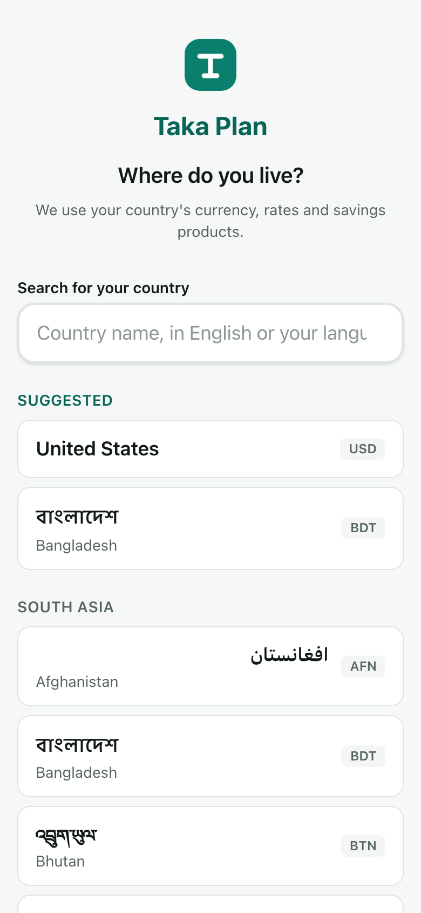
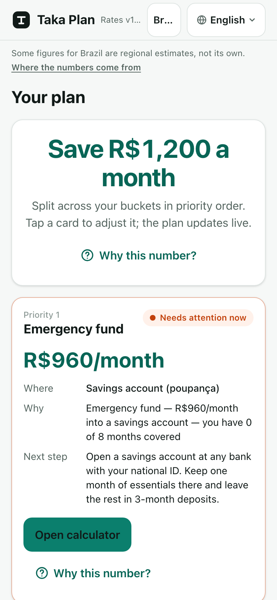
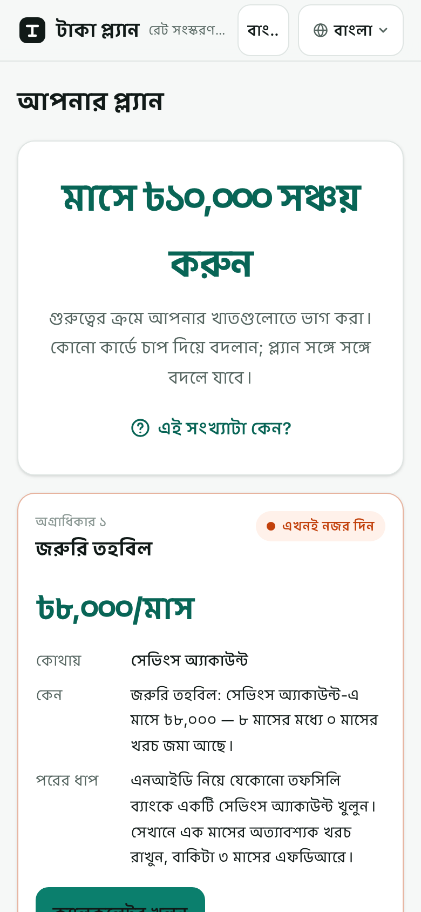
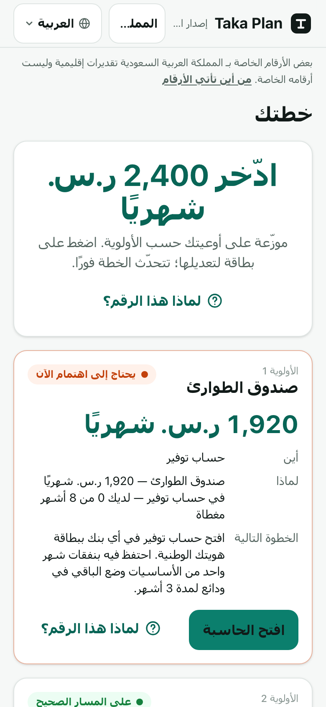
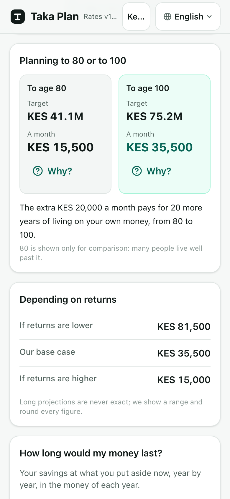
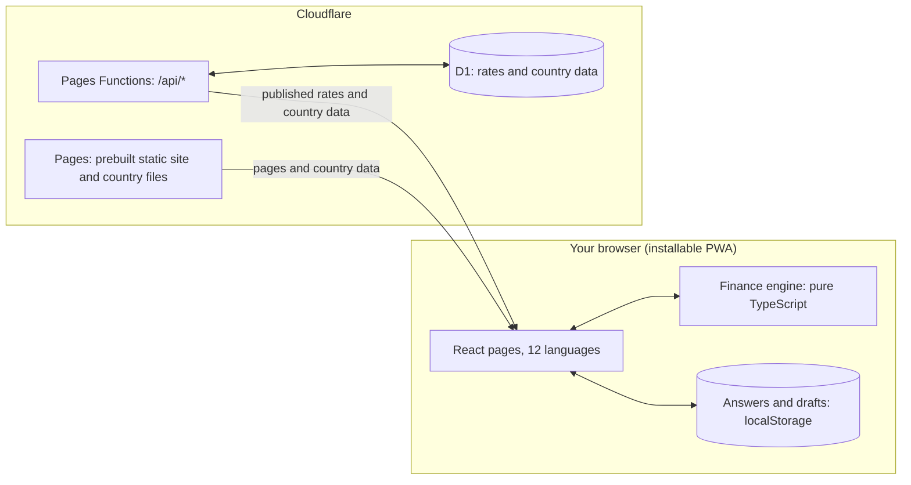

<div align="center">


# Taka Plan

**How much you need for each goal, and where to put it every month.**

প্রতিটি লক্ষ্যের জন্য কত টাকা লাগবে, আর প্রতি মাসে সেই টাকা কোথায় রাখবেন।

A free personal-finance planner for everyone, in any country.<br>
Made in Bangla and English, now in 12 languages.

### [Open Taka Plan →](https://taka-plan.pages.dev)

No sign-up. No ads. Nothing to install.

[](https://taka-plan.pages.dev)
[](#made-for-everywhere)
[](#made-for-everywhere)
[](LICENSE)
[](https://github.com/sm-supports/taka-plan/actions/workflows/ci.yml)

<br>

&nbsp;
&nbsp;
&nbsp;
&nbsp;


<sub>Sample answers, not real people's money.</sub>

</div>

## How it works

1. **Pick your country and language.** Your currency, rates and local savings products follow.
2. **Answer five short questions.** Age, income, essential spending, dependents and debt.
3. **Get one monthly plan.** One amount to save, split in priority order, with a next step for each part.

Change an answer and the plan updates straight away. If you want to start over, your old answers are kept as a draft.

## Seven steps: protect, save, grow

Your plan follows a fixed order, because a retirement fund doesn't help if one hospital bill wipes it out. Each step is a small calculator you can open on its own.

| | Step | The question it answers |
| --- | --- | --- |
| 🛡️ Protect | [Emergency fund](https://taka-plan.pages.dev/en/m1) | How much should I keep within reach if my income stops? |
| 🛡️ Protect | [Insurance & health](https://taka-plan.pages.dev/en/m2) | How much cover does my family need, and how do I check an insurer? |
| 🛡️ Protect | [Debt health check](https://taka-plan.pages.dev/en/m3) | Which loan or card do I pay off first? |
| 💰 Save | [Save-first budget](https://taka-plan.pages.dev/en/m4) | How do I save on payday and live on the rest? |
| 🌱 Grow | [Goal planner](https://taka-plan.pages.dev/en/m5) | What does a real goal, with an amount and a date, cost me each month? |
| 🌱 Grow | [Asset mix](https://taka-plan.pages.dev/en/m6) | How should I split long-term money between fixed income, equity and gold? |
| 🌱 Grow | [Retirement & family](https://taka-plan.pages.dev/en/m7) | How much do I need to live on my own money, on my own terms, to 100? |

## What makes it different

- **Your answers stay on your device.** All the maths runs in your browser. There are no accounts and no analytics, and your answers are never sent to a server.
- **Every number explains itself.** Tap "Why this number?" to see the steps and the rates behind any result.
- **It doesn't push products.** It never names a bank, fund or insurer. It tells you the type of product to look for.
- **It shows what you actually keep.** Returns are shown after tax and after inflation, not just the headline rate.
- **It's honest about the future.** Long projections come as a range, and retirement plans run past the average lifespan, because many people outlive it.
- **It's built for phones and slow connections.** You can install it, and pages you've visited work offline.

## Made for everywhere

Each of the **197 countries** has its own profile: currency and number format, inflation, deposit and bond rates, tax on interest, insurance and health costs, retirement age, public pensions, and local names for savings products.

| | | | |
| --- | --- | --- | --- |
| বাংলা | English | हिन्दी \* | اردو \* |
| العربية \* | Español \* | Français \* | Português \* |
| Bahasa Indonesia \* | 简体中文 \* | Русский \* | Kiswahili \* |

<sub>\* Translated from English and not yet reviewed by a native speaker. Urdu and Arabic read right to left.</sub>

The name comes from *taka*, the currency of Bangladesh, where the project began. Bangla is still its first language:

> **টাকা প্ল্যান** একটি ফ্রি অ্যাপ, যা আপনার টাকার পরিকল্পনা করতে সাহায্য করে। আপনার দেশ আর ভাষা বেছে নিন, পাঁচটি ছোট প্রশ্নের উত্তর দিন, তারপরই পেয়ে যাবেন আপনার মাসিক সঞ্চয়ের প্ল্যান। কোনো অ্যাকাউন্ট লাগবে না। আপনার উত্তর আপনার ফোনেই থাকে। [এখনই শুরু করুন →](https://taka-plan.pages.dev)

## How far to trust the numbers

Treat every figure as a starting point, and check it with your bank or insurer before you act. Across all countries, the profiles hold 9,259 figures:

| Status | Figures | Share | What it means |
| --- | ---: | ---: | --- |
| Sourced | 2,875 | 31% | Taken from a published source, linked with its date |
| Our assumption | 3,546 | 38% | A default we chose, and labelled as ours |
| Not found | 2,794 | 30% | No reliable figure; the app uses a regional estimate and says so |
| Doesn't exist | 44 | <1% | Research confirmed that country has no such thing |

The app shows this too: when a country relies on regional estimates, a note says so and links to where the numbers come from. Small countries have the most gaps, and rates and tax rules change several times a year.

## Help make it better

This is what would help most:

- **Review a translation.** If you're a native speaker of one of the starred languages, tell us what reads wrong, especially the finance terms.
- **Correct a figure.** If your country's numbers are out of date or missing, [open an issue](https://github.com/sm-supports/taka-plan/issues) with the correct value and a link to the source.

## For developers



Your answers never leave the browser. The server only publishes rates and country data, edited through a password-protected admin.

**Built with** TypeScript, React 19, [vinext](https://github.com/cloudflare/vinext) (static export), Tailwind CSS, Zustand, Cloudflare Pages + Functions + D1, Vitest and Playwright.

### Run it locally

You need Node 24 (see `.nvmrc`).

```bash
nvm use && npm ci && cp .dev.vars.example .dev.vars
npm run db:migrate:local
npm run build && npm run preview   # http://localhost:8788, same runtime as production
npm run dev                        # http://localhost:3001, fast UI work without the API
```

### Where things are

| Path | What's there |
| --- | --- |
| [`packages/engine`](packages/engine/src) | All the finance maths, one module per step, with no I/O or React |
| [`packages/engine/src/data/countries`](packages/engine/src/data/countries) | One researched JSON profile per country |
| [`app`](app), [`components`](components) | Pages and UI |
| [`lib/i18n/dictionaries`](lib/i18n/dictionaries) | Translations, one folder per language |
| [`server/api`](server/api), [`functions/api`](functions/api), [`migrations`](migrations) | The API and the database |

### Read more

[Architecture](docs/ARCHITECTURE.md) · [Commands and gotchas](docs/TOOLING.md) · [Deployment](docs/DEPLOY.md) · [Bangla style guide](docs/BANGLA-STYLE.md) · Product specs: [core](docs/PRD.md), [insurance](docs/PRD-insurance.md), [asset mix](docs/PRD-allocation.md), [retirement](docs/PRD-retirement.md)

## Licence and disclaimer

The code is released under the [MIT licence](LICENSE).

Taka Plan gives estimates for education only. It is not financial, tax or legal advice. Past returns don't predict future returns.
